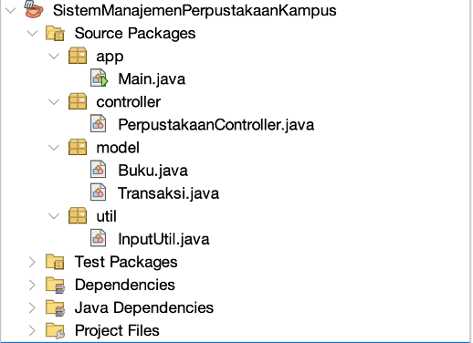

# Sistem Manajemen Perpustakaan Kampus
Sistem Manajemen Perpustakaan Kampus merupakan program berbasis Java Command Line Interface yang dirancang untuk membantu proses pengelolaan sederhana pada perpustakaan kampus. Program menangani data kategori buku, data koleksi buku lokasi penyimpanan buku, antrean mahasiswa, proses peminjaman, riwayat transaksi, dan statistik peminjaman. 

## Tugas Pemrograman Java
•⁠  ⁠**Mata Kuliah:** Pemrograman Berorientasi Objek
•⁠  ⁠**Dosen Pengampu:** M. Ibadurrahman Arrasyid Supriyanto M.Kom.
•⁠  ⁠**Program Studi:** Sistem Informasi
•⁠  ⁠**Angkatan:** 2025
•⁠  ⁠**Kelompok:** 13
  
## Anggota Kelompok 8 (UBAH)
1.⁠ ⁠*Zefri Al Rizqullah* - 2509116084 - Kelas C
2.⁠ ⁠*Eko Satrio Wibowo* - 2509116028 - Kelas A
3.⁠ ⁠*Rasya Aditya Ramadani* - 2509116082 - Kelas C
3.⁠ ⁠*Ahmad Ribbiy Aldi* - 2509116100 - Kelas C

## Struktur File Proyek
Project Sistem Manajemen Perpustakaan Kampus dibuat menggunakan bahasa pemrograman Java dan dijalankan dalam bentuk Command Line Interface (CLI). Program dibagi menjadi empat package utama, yaitu app, model, controller, dan util.

Pembagian package dilakukan berdasarkan fungsi masing-masing bagian program. Package app digunakan sebagai tempat class utama yang menjalankan program. Package model digunakan untuk merepresentasikan objek atau data yang digunakan dalam sistem. Package controller berisi proses utama dan logika pengolahan data perpustakaan. Sementara itu, package util berisi fungsi pendukung yang digunakan untuk menangani dan memvalidasi input pengguna.